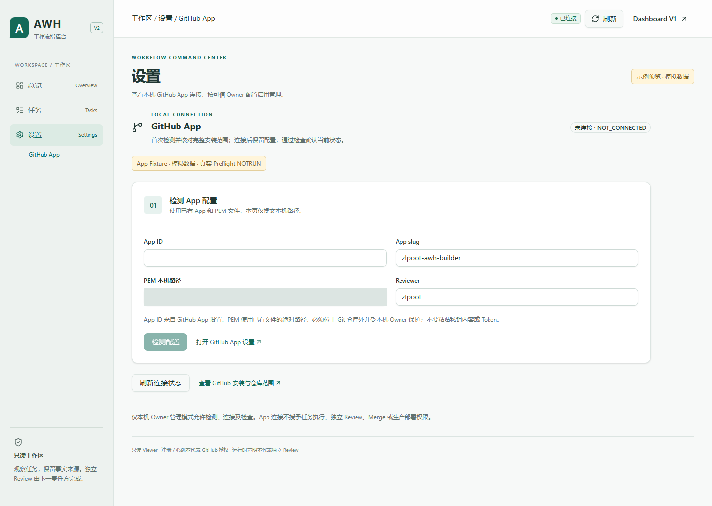
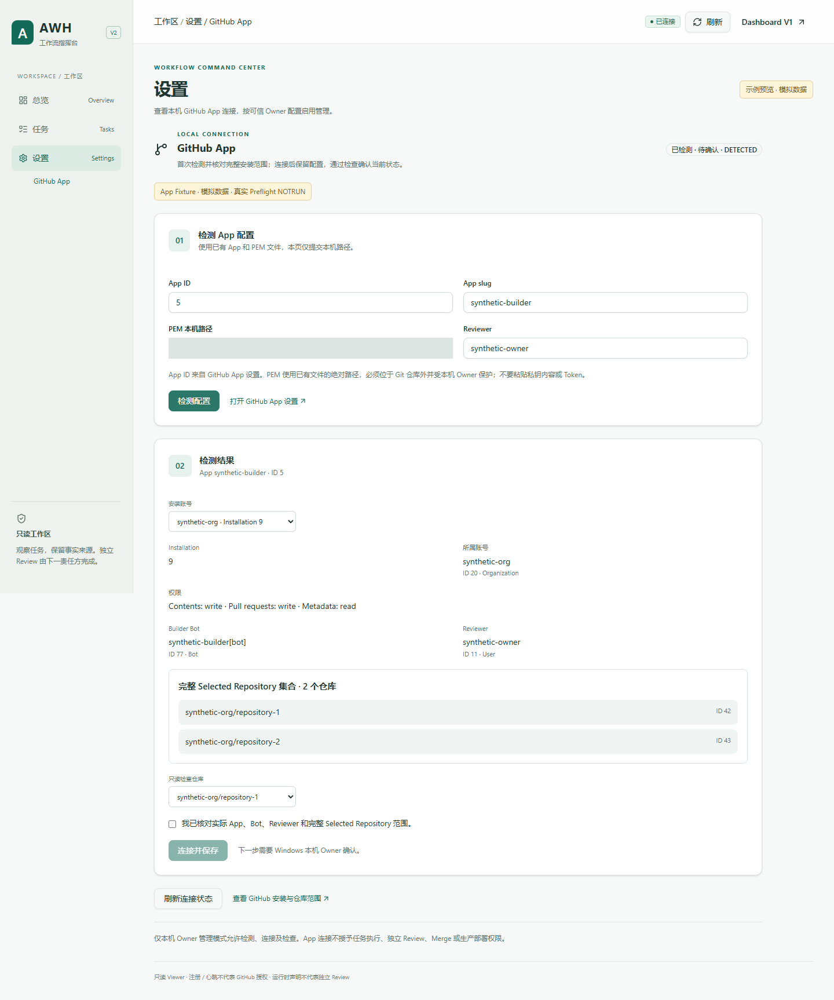
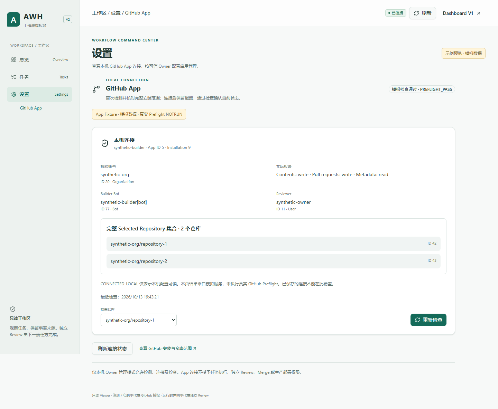
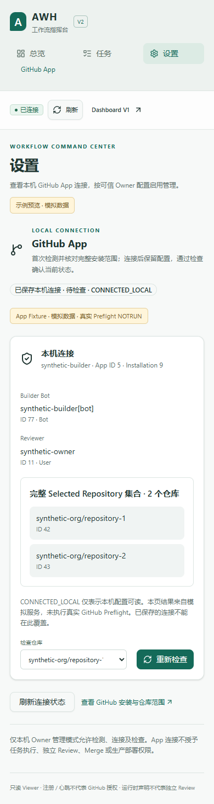
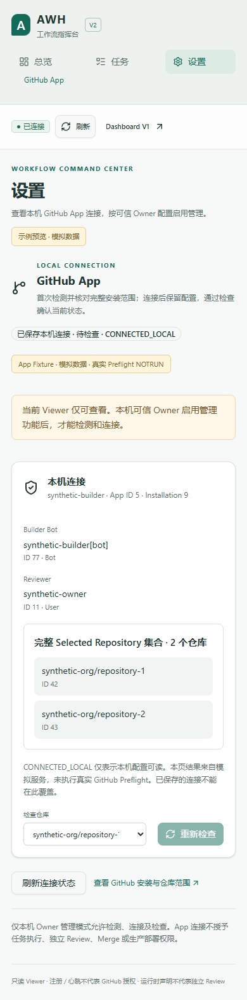
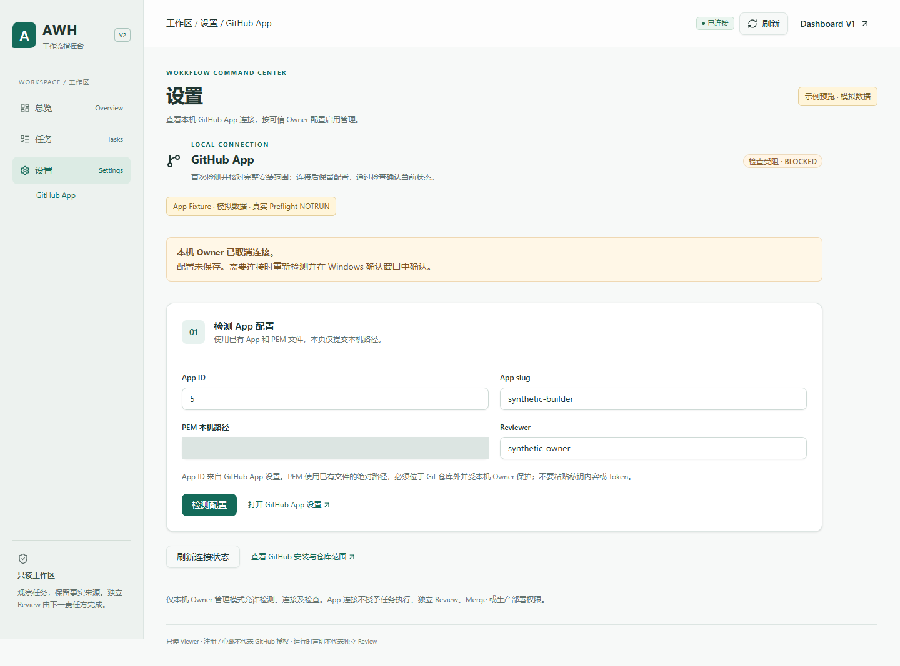
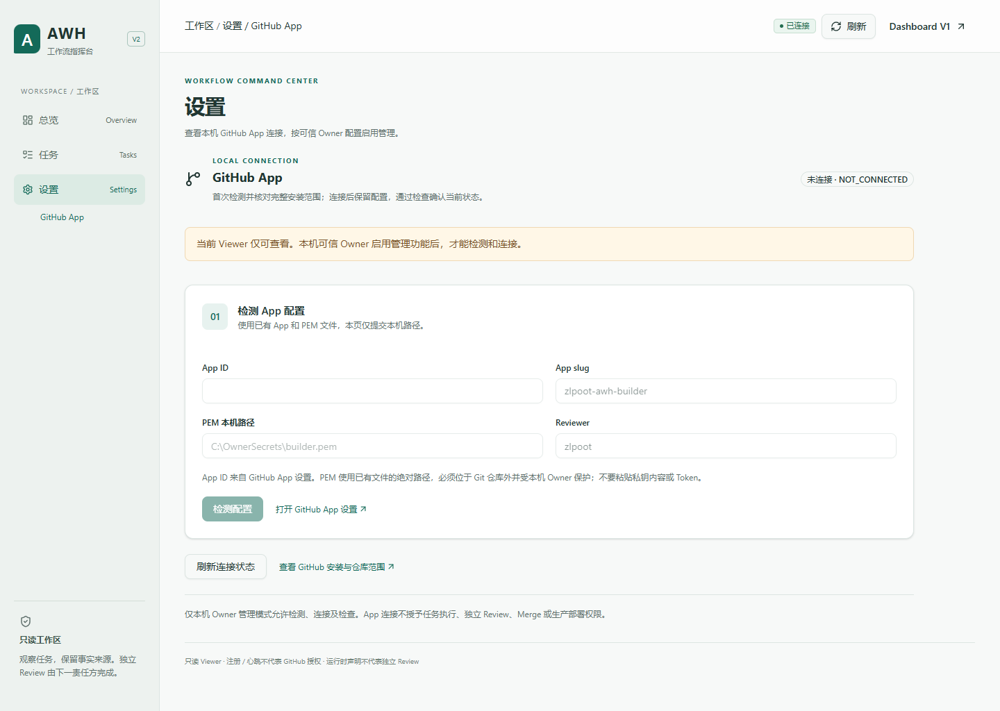

# Dashboard V2 · GitHub App 设置（Issue #84）

以 Owner 指定 main `ac9cdcf3fd301fe9d6e169119dd1a937e3834d88` 为基线，独立分支 `codex/issue84-v2-github-app-settings`。V2 设置 → GitHub App 复用 V1 无 UI 的共享 hook 和既有服务端管理流程；V1 页面保留。服务端权限、CSRF、检测 TTL、受保护状态、Windows Owner SID/helper digest 与确认机制未修改。

## GitHub 可读取的截图

以下来自真实 Windows Edge 浏览器的隔离 Fixture 测试。App、身份、仓库和确认均为模拟；每张截图均明确标注模拟状态，**真实 detect/connect/Preflight 与真人原生 Owner UI 为 NOTRUN**。PEM 路径在截图中遮蔽，不包含 PEM/JWT/Token 或用户私密路径。

下面来自**离线安装的本轮正式 Viewer 包**，使用全新 Windows 配置、App 配置根及非生产 CP 数据库，没有 Owner 管理 policy，也没有 Fixture 注入。设置页可读取状态；检测/连接/检查不可写。

## 定向验证与限制

`pnpm typecheck`、`pnpm build`、本地 Viewer 打包，随后执行 App dashboard / Windows Owner boundary / Gateway / UI / V2 定向测试。浏览器执行 `dashboard:v2:app-smoke`、V1 `github-app-dashboard-smoke`、V2 原 Overview/Tasks/Drawer Smoke，以及真实安装的 `dashboard:v2:viewer-smoke`。准确干净 HEAD、退出码与本地原件在 gitignored `.handoff/final/`，最终结果在 Draft PR 中列明；未运行大型全量 CI。

Fixture 浏览器覆盖未连接、已连接、只读、完整 selected-set、确认重勾选、错误/取消/跨页面并发、卸载中止、键盘 Enter、390px、同源固定 POST 字段与一次性 CSRF、CSP/无浏览器存储。Windows helper 测试使用真实隔离 ACL/SID/digest，但 child ACK 是模拟；不代表真人确认。正式安装 Viewer 的设置状态请求和任务 REST/SSE 均为 GET；V1 回退可用，测试库读取字节不变。

真实设置页新 App 连接与 Windows 真人 Owner 确认环境未另行 provision，**NOTRUN**；既有 App 仅用于获授权的 Draft 发布，不连接生产 App。Mac 真机、生产 Cutover、完整 Release 均 **NOTRUN**。这些本地结果不是独立 Review，也不是正式 Builder Evidence/Handoff/CP Run。停在 `AWAITING_INDEPENDENT_REVIEW`，不 Merge、关闭 Issue、Release 或部署。
