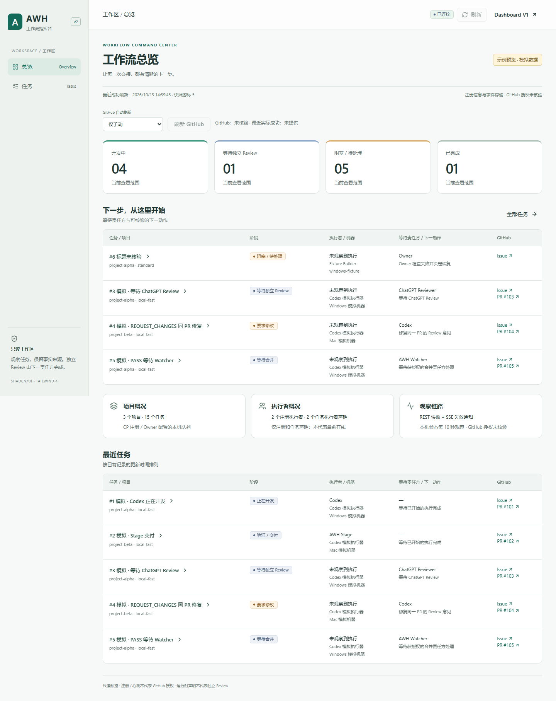
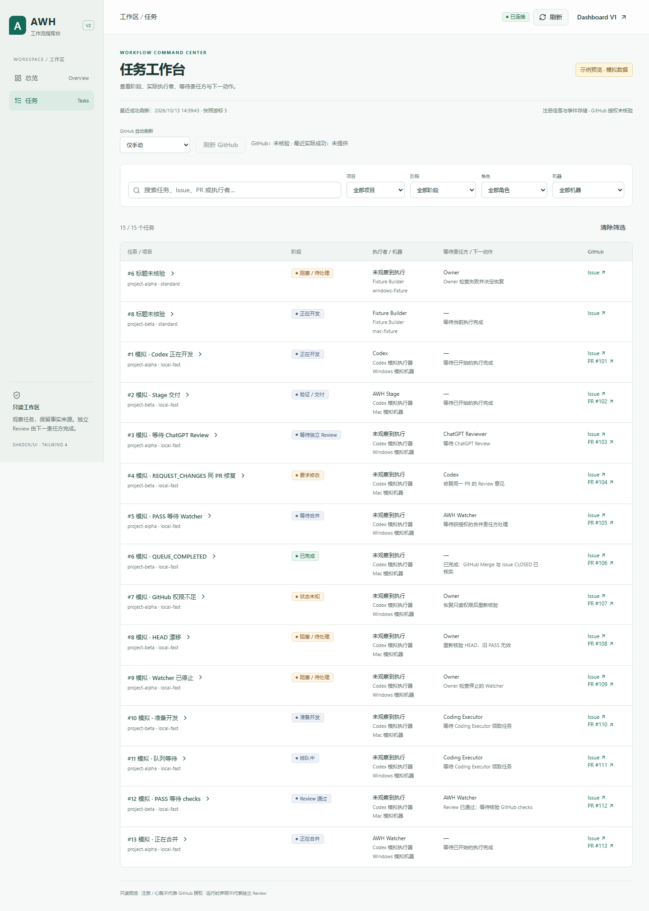
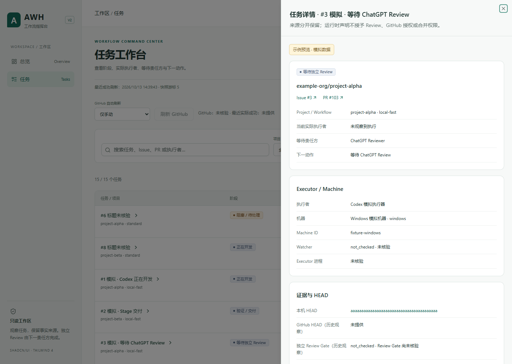
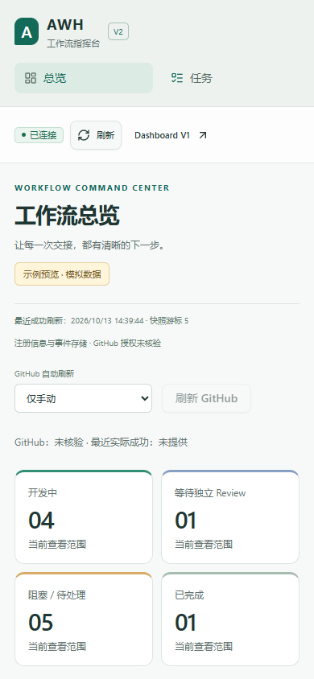
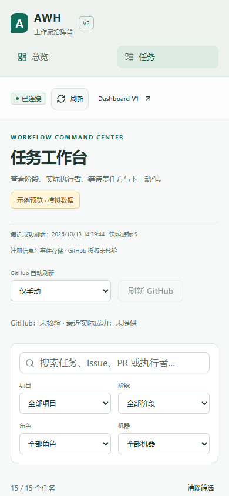
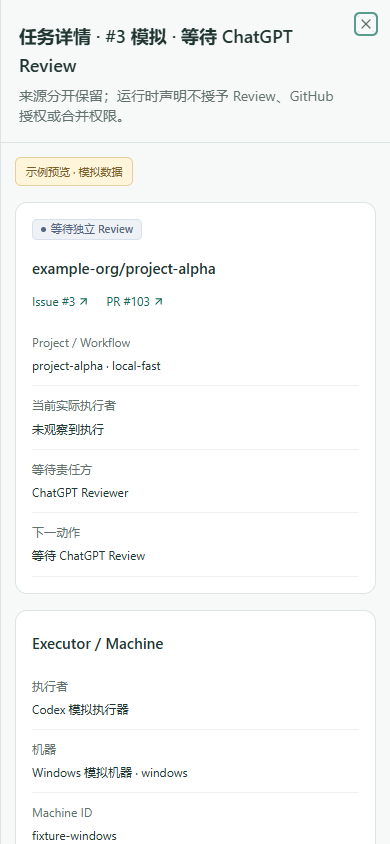

# Dashboard V2 PoC B · Issue #87

本 PoC 从 PR #85 已合并的固定 main 基线 `8470e51bec7c5a5a5c4301b6900c6a8c5cc05503` 创建，分支 `codex/dashboard-poc-shadcn`。Owner 于 2026-10-13 正式启动；后续明确豁免本任务 AGENTS.md 的发布授权要求。发布使用已有受保护 GitHub App，保持 Draft，停在 `AWAITING_INDEPENDENT_REVIEW`。最终精确 HEAD 和验证命令退出码记录在 Draft PR 与本地 `.handoff/final-verification.json`；不生成正式 Builder Evidence / Handoff / CP Run。

## 可交互预览

Node >=24、仓库固定的 pnpm 11.25.0，在本分支 Worktree 运行：

```powershell
pnpm install --frozen-lockfile
pnpm build
pnpm dashboard:v2:build
pnpm dashboard:v2:preview
```

终端打印 `http://127.0.0.1:<随机独立端口>/dashboard/v2`。打开该完整地址建立仅限一小时的 HttpOnly Viewer fixture 会话。预览只监听 loopback；使用全新内存 SQLite、fixture 身份、原 `dashboardRoute` 与 `dashboardHeaders`，无生产路径/凭据/CP 输入。`/dashboard` 同时提供原 V1，用于对照。Ctrl+C 关闭，或一小时后自动退出。V2 输出仅在 `dist/dashboard-v2/`；V1 的 `dist/dashboard-ui/` 和 `/dashboard/app.js`、`/dashboard/app.css` 保留。

所有预览均显著标记“示例预览 · 模拟数据”。数据直接复用固定基线的 `tests/task-fixture.mjs`、协议 examples 和 CP 脱敏投影，没有为 B 编造不同状态。A 分支可以复用这些基线 fixture 进行一致对照；本任务未读取或同步 A 的 UI 工作区。此 PoC 没有部署到生产 Gateway；页面不接受任意后端 URL。真实同源集成仍需后续迁移任务。

## 范围与结构

Overview 展示项目/执行者声明概况、开发中/等待独立 Review/阻塞与待处理/完成统计、下一责任方与下一动作、最近任务。Tasks 支持项目/阶段/角色/机器组合筛选、Issue/PR/执行者搜索、清除筛选、安全 GitHub 跳转和异步详情 Sheet。

`app.tsx` 仅负责组合视图和选择任务；`hooks/use-dashboard.ts` 管理 Reader 生命周期、10 秒本机轮询、5 秒时效检查及可取消的详情请求。`pages/` 只组合基础组件。`components/` 包含 AppShell、统一 Status、共用 TaskList、TaskDetail、GitHubObservation、原生 Select；`components/ui/` 是官方 shadcn 源码。任务时效与筛选集中在 `lib/task-model.mjs`，复用 V1 `task-freshness.mjs`。没有两份 Button/Badge/Table/Drawer 页面实现，也没有引入复杂表格框架。

`DashboardReader`、REST/SSE 和生成的 OpenAPI 校验器直接复用。保留本机轮询与 GitHub 独立观察、手动刷新/0/60/300 秒选项和重试退避；Reader、业务逻辑、契约、GitHub App、Owner/CSRF/PEM/JWT/Token 隔离源码未修改。断线、过期、详情失败会降级当前状态与执行者；历史 HEAD、Review Gate、Stage、Checks、scope 单独注明历史观察。注册数量不声称在线，注册/心跳不等于 GitHub 授权。

## 组件来源与构建兼容性

通过 [shadcn 官方 Registry](https://ui.shadcn.com/docs/registry) 的 `new-york-v4` 引入 Button、Badge、Card、Input、Table、Sheet；URL、原始 Registry 响应 SHA-256、调整记录见 `dashboard-v2/registry-sources.json`。`scripts/dashboard-v2-registry.mjs` 是显式重新导入工具，常规构建不访问 Registry。调整仅为 `cn` 相对导入和 Sheet 关闭标签中文化；来源 MIT 许可随源码保留。

遵循 [Tailwind CLI 静态 CSS 安装方式](https://tailwindcss.com/docs/installation/tailwind-cli)：Tailwind/CLI **4.3.3**，shadcn 依赖精确版本固定在 package/锁文件，包括 radix-ui **1.8.0**、Lucide **1.55.0**、CVA **0.7.1**、tailwind-merge **3.7.0**。CSS 显式仅扫描 V2；主题通过统一 CSS variables / Tailwind theme tokens。CLI 先生成独立静态 CSS，esbuild **0.28.2** 打包 React **19.3.0** 和静态校验器，无运行时 CSS CDN、eval、外部字体或服务端依赖。

原 Gateway CSP 原样用于预览：`script-src 'self'`，`style-src 'self' 'unsafe-inline'`，`connect-src 'self'`。浏览器检测了实际 Header、securitypolicyviolation、脚本/样式加载和 Sheet 交互，无 CSP 违规。Radix 可使用 CSP 已允许的内联样式；本 PoC 没有收紧或放宽生产策略。

当前构建体积（精确 HEAD 的原始报告另见 `dist/dashboard-v2/build-report.json` / final verification）：

| 产物 | 原始 bytes | gzip bytes |
| --- | ---: | ---: |
| app.js | 566,594 | 131,133 |
| app.css | 32,774 | 7,602 |
| index.html | 373 | 254 |

首次安装 pnpm 拒绝可选 `@parcel/watcher` 安装脚本；明确设置 `allowBuilds['@parcel/watcher']=false` 后冻结安装和单次 CLI 编译通过，不需要额外 native build。初版浏览器构建边界过于宽泛，将第三方包的 `src` 误判为业务源码；现改为拒绝仓库 `src/`、Node builtins 和 Builder 输入。未放宽实际服务器边界。

## 验证与截图

```powershell
pnpm typecheck
pnpm build
pnpm dashboard:v2:build
node --test --test-force-exit --test-timeout=90000 tests/dashboard-ui.test.mjs tests/dashboard-tasks.test.mjs tests/dashboard-gateway.test.mjs tests/dashboard.test.mjs tests/dashboard-dataset.test.mjs tests/dashboard-v2.test.mjs tests/github-app-dashboard.test.mjs
pnpm dashboard:v2:smoke
$env:AWH_DASHBOARD_TEST_BROWSER='C:/Program Files (x86)/Microsoft/Edge/Application/msedge.exe'
pnpm dashboard:smoke
git diff --check
```

Dashboard 定向 **66/66 PASS**；V1/V2 真实 Edge **155.0.4283.45** Smoke PASS。相关 GitHub App 身份、完整 Selected 集合、最小 Token、私有 PR 权限与 Git 传输检查 **21/21 PASS**，命令如下；不声称完整 App 流程通过。

```powershell
node --test --test-force-exit --test-name-pattern='^(one-time connect|App connection and token boundaries|pinned installation|complete selected-set|operation-minimum|private repository Draft|transport refuses|askPass (local|worktree))' tests/github-app.test.mjs
```

V2 的测试自动使用本机 Edge（也可用上述环境变量指定 Chromium）。覆盖桌面 1440×1024 和 390×844、搜索/组合筛选、GitHub 观察选项、键盘 Enter/Tab focus trap/Escape 与焦点返回、详情失败/断线降级、恢复读取、loading/live/outdated/offline/error/empty。partial 使用实际 Timeline DTO 和测试专用 EventSource double 触发 Reader 同步状态；不是生产端到端事件回放。记录预期注入的 offline/503 错误；非预期 browser_errors=0、csp_violations=0。Drawer 焦点恢复初次 Smoke 失败已修复，原始失败日志保留。

截图来自真实浏览器、共同模拟数据；移动截图为实际 390px viewport，详见 [截图目录](dashboard-v2-shadcn/)。








## 已知限制与统一比较

- PoC 只交付 Overview/Tasks 和独立 fixture 预览；未替换生产 Dashboard，未验证生产真实数据或所有浏览器，Tailwind 4 面向现代浏览器。包体包含静态完整契约校验器，未做代码分割或性能基准。
- 附加完整 `tests/github-app.test.mjs` 中既有 `askPass 401 challenge...` 子进程用例未退出，被人工中止并保留原始日志；不是 PASS。只报告上述聚焦的 21 个用例，完整 App Stage/Watcher 模拟流程本轮未完成。该用例/安全源码未为 PoC 改写。
- 第一轮截图/测试支持可维护性、易用性、接口兼容性、组件复用、构建与性能的统一比较（权重 30%/25%/20%/15%/10%）；不代替独立 Review，也不在未取得 A 证据时给出胜负或分数。
- Owner 明确要求的第二轮同题 AI 修改实验 **DEFERRED / NOTRUN**。本轮未添加“仅显示等待独立 Review”专用切换或详情“最近更新时间”实验字段；机器基础展示源自首轮范围。等待统一指令后再进行修改稳定性实验。

原始结果和失败保存在 gitignored `.handoff/logs/` 与 `.handoff/dashboard-v2-smoke/`。新提交必须重新验证最终干净 HEAD。停在 `AWAITING_INDEPENDENT_REVIEW`；不得自动批准、合并、关闭 Issue、发布 Release 或部署生产服务。
